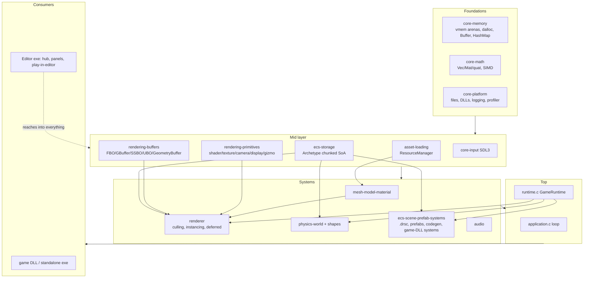

# Druid Engine — Architecture (Stage 2 synthesis)

Synthesized entirely from `docs/modules/*.md` (Stage 1). Source files were not
re-read; where the module docs themselves were unsure, the item is flagged in
§5 rather than guessed at.

**What Druid is:** a C11 engine DLL (`libdruid.dll`) with one monolithic public
header (`include/druid.h` — every struct and ~505 function declarations for all
modules; there are no per-module headers, and `CMAKE_WINDOWS_EXPORT_ALL_SYMBOLS`
exports everything). On top of it sit a C++17 ImGui **editor** (project hub,
scene editing, play-in-editor via a hot-loaded game DLL) and generated **game
projects** (a `game` DLL exporting `druidGetPlugin` + per-archetype ECS systems,
plus a `game_standalone` launcher exe). State is dominated by global singletons:
`g_memory`, `resources`, `display`, `renderer`, `physicsWorld`, `sceneRuntime`,
`runtime`, `audio`, `prefabRegistry`.

---

## 1. System map and call order

### Dependency layers



Everything includes only `druid.h`, so “layering” is by convention, not
enforced — see §4 for where it is violated.

### Context A — standalone game (application.c + runtime.c)

**Init** (`run(app)` → `initSystems`), in exact order:

1. `memLoadConfig("memory.conf")` (fallback `../memory.conf`) → `memorySystemInit` — one VM block carved into GENERAL/ECS/RENDERER/PHYSICS/FRAME arenas (defaults 256/256/96/128/128 MB).
2. `initLogging()` (currently a no-op).
3. `createResourceManager(8192 mats, 2048 tex, 8192 meshes, 2048 models, 128 shaders, 256 audio)` → global `resources`.
4. `profileCalibrate()` (RDTSC vs SDL timer).
5. `initDisplay(title, w, h)` — SDL window + GL context (defaults 1920×1080); `initInput` happens inside display init.
6. `resources->geoBuffer = geometryBufferCreate(2M verts, 6M indices)` — the shared mega VBO/EBO all static meshes prefer.
7. Resource scan: probe `./res` vs `../res` → `readResources` (textures first, then models via Assimp, shaders, audio) → `loadTextureMetadata("textures.meta")`.
8. `audioInit()` (SDL device, 32 voices, music stream).
9. **`app->init()`** — game code. The generated template calls `runtimeCreate(projectDir, runtimeDefaultConfig())`, which in standalone mode: `sceneRuntimeInit` (startup scene from `startup_scene.txt`, else first `scenes/*.drsc`), `prefabRegistryCreate` + `prefabLoadDirectory`, `createRenderer` + default shader + camera + `rendererEnableDeferred`, `physInit` + `physAutoRegisterScene`, loads `gbuffer`/`deferred_lighting` shaders and the skybox. Game code then creates its archetypes (`createArchetype(&Name_layout, ...)`) and calls `runtimeRegisterArchetype`.
10. `SDL_FlushEvents`, timer seed.

**Per frame** (`startApplication`):

```
frameReset()                      // frame arena wiped — frameAlloc'd ptrs die here
profileBeginFrame()
dt from SDL performance counter
inputUpdate(app)                  //  app->inputProcess hook (if set) + updateInputAxes
app->update(dt)                   // game logic; ECS system updates;
                                  // generated template ends with runtimeUpdate(rt, dt):
                                  //   - flush pending physics registrations
                                  //   - physWorldStep(physicsWorld, dt)   [standalone]
                                  //   - rendererBeginFrame(renderer, dt)  [standalone]
audioPump()                       // reap SFX voices, refill music
applicationRenderStep:            // clearDisplay -> app->render(dt) -> swapBuffer
                                  // generated render: runtimeBeginScenePass (G-buffer bind,
                                  //   scene draw) -> [game/archetype draws] ->
                                  //   runtimeEndScenePass (lighting pass, skybox)
profileEndFrame(); FPS accounting
```

Note the engine loop itself never steps physics or begins the renderer frame —
`runtimeUpdate`, called from *game* update code, does both. `frameReset` at the
top of frame invalidates everything `frameAlloc`'d last frame (light staging,
`renderer->frameVisible`, physics visibility buffer).

**Shutdown** (`destroyApplication`): `saveTextureMetadata` → `app->destroy()`
(template: `runtimeDestroy` — `physShutdown`, `sceneRuntimeDestroy`, free
skybox/deferred shaders, `prefabRegistryDestroy`) → `audioShutdown` →
`onDestroy(display)` → `shutdownLogging` → `cleanUpResourceManager` →
`memorySystemShutdown` → `free(app)`.

### Context B — the editor (and play-in-editor)

The editor is itself two `Application` lifecycles run back-to-back from
`Editor/src/main.cpp`: the **hub** (project picker/creator, `projects.conf`),
then the **editor** proper.

**Editor init:** create `sceneArchetype` from the compiled-in 35-field
`SceneEntity` layout → `rebindArchetypeFields()` (refresh ~35 global column
pointers) → ImGui → editor shaders from `../res/` → `createRenderer` + editor
camera slot → gizmos + primitive registration → ID-pick framebuffer + viewport
FBO chain → auto-load first `scenes/*.drsc` (adopt the loaded archetype as
`sceneArchetype`, `migrateSceneArchetypeIfNeeded` name+size-matched schema
upgrade, rebind again) → `scanProjectArchetypes` → project `readResources` +
deferred `sceneRemapModelIDs`.

**Editor frame:** `processInput` (SDL pump → ImGui, input-capture routing;
raw input passes through when the viewport is hovered or a game is running) →
`update` (gizmo drag, camera fly, F5/Shift-F5/Ctrl-S/copy-paste hotkeys) →
`render` → `drawDockspaceAndPanels()` which draws every panel and, from
`drawViewportWindow`: resize FBOs → sync `sceneCam` into the renderer camera →
`renderIDPass` (entity picking) → `renderGameScene` → post-process into
`finalDisplayFB` → ImGui image. `renderGameScene` **reuses the engine's
deferred plumbing but not its submission path**: edit mode draws SceneEntities
one-by-one (no culling, no instancing) into the G-buffer, then
`rendererLightingPass` with the editor's own lighting shader, then editor-drawn
skybox and gizmos. During play the same function mixes immediate scene draws
(unclaimed entities) with the runtime path (`g_ecsSystems[a].render` or
`rendererDefaultArchetypeRender`) plus `g_gameDLL.plugin.render(dt)`.
`drawDockspaceAndPanels` also runs `physTick(dt)`, `plugin.update(dt)`,
per-archetype system updates, and `syncEcsToScene()` each play frame.

**Play-in-editor** (`doBuildAndRun`): build game project (CMake) → load game
DLL (`druidGetPlugin`) → **snapshot scene** to `__play_snapshot__.drsc` →
`plugin.init(projectDir)` → discover `druidGetECSSystem_<Name>` per registry
archetype → `populateEcsArchetypes()` (build per-system archetypes from scene
entities by `archetypeID`, name+size field mapping) → `physInit` + register
physics archetypes + a synthetic "ScenePhysics" archetype for plain static
colliders → `g_gameRunning = true`.
**Stop** (`doStopGame`) tears down in the reverse-dependency order that
matters: ECS system `destroy()`s → `physShutdown` → destroy ECS/scene-physics
archetypes **before** unloading the DLL (their layouts live in DLL memory) →
`plugin.destroy()` → `unloadGameDLL` → `restoreSnapshot()`.

---

## 2. ECS deep-dive

### Storage model (ecs-storage)

An `Archetype` owns two flat blocks — `hotData` and `coldData`, split by
per-field `FieldTemperature` (`ARCH_NO_SPLIT` puts everything cold). Layout is
**field-major across the whole archetype**: each field is one contiguous array
of `totalCapacity` elements. "Chunks" (`EntityArena`) are pure pointer windows
into those blocks (`chunk->fields[f][localIdx]`; global
`poolIdx = chunkIdx * chunkCapacity + localIdx`); a field's data is contiguous
*across* chunk boundaries, so chunk iteration is a convention, not a memory
boundary. Chunk capacity = `chunkSizeBytes` (default 128 KB, settable via
`archetypeSetChunkSize` *before* `createArchetype`) / entitySize, rounded down
to a multiple of 4.

Two entity regimes:

- **Dense** (`createEntityInArchetype` / `removeEntityFromArchetype`):
  swap-remove — indices are **unstable** across removal.
- **Pooled** (`ARCH_BUFFERED`): field 0 is a `b8 Alive` flag (by convention —
  the codegen auto-prepends it; nothing validates it), `deadIndices` free-list,
  `archetypePoolSpawn`/`Despawn`/`IsAlive`. Indices are **stable** across
  spawn/despawn *and* growth; chunk `count` is a high-water mark, so iterators
  must test `Alive`.

`EntityRef {arch, poolIdx}` is stable only for buffered archetypes.
Growth (`archetypeGrow`, triggered by spawn when full) preserves indices and
the `void**` array from `getArchetypeFields` (rewritten in place), but
invalidates cached `hotData`/`coldData` pointers, cached field-element
pointers, and `EntityArena*` chunk pointers. Other flags: `ARCH_SINGLE`
(capacity 1), `ARCH_PERSISTENT` (survives scene switches), `ARCH_PHYSICS_BODY`
(auto-registered with physics).

### How a system runs

Game systems live in the **game DLL**. For each archetype the editor generates
`<Name>.h` (sentinel-wrapped `NAME_FIELDS(FIELD)` X-macro +
`DECLARE_ARCHETYPE`) and a never-overwritten `<Name>.c` skeleton
(`DEFINE_ARCHETYPE` instantiating `Name_fields[]`/`Name_layout`, plus
`<name>Init/Update/Destroy/GetArchetype/Spawn` and the export
`druidGetECSSystem_<Name>(ECSSystemPlugin *out)`). The plugin vtable is
`{init, update(Archetype*, f32 dt), render(Archetype*, Renderer*) /*nullable*/,
destroy}`; a NULL `render` means the engine uses
`rendererDefaultArchetypeRender`. The working loader is
`loadECSSystemFromHandle(dllHandle, archetypeName, out)` (tries
`druidGetECSSystem_<Name>`, falls back to legacy `druidGetECSSystem`);
`loadECSSystemDLL`'s per-archetype branch is unreachable (it zeroes `out` then
reads `out->name`). Who calls `update` each frame: game code in standalone,
`drawDockspaceAndPanels` in the editor.

A generated `Update` body iterates chunks:

```c
for (u32 c = 0; c < archetypeChunkCount(arch); c++) {
    void **f = getArchetypeFields(arch, c);
    b8  *alive = (b8*)f[NAME_ALIVE];
    f32 *px = (f32*)f[NAME_POSITION_X];       // generated enums index fields
    u32 n = arch->arena[c].count;
    for (u32 i = 0; i < n; i++) { if (!alive[i]) continue; /* ... */ }
}
```

### Add / remove a component at runtime

You can't. Layouts are fixed at `createArchetype`; there is no per-entity
add/remove-component operation anywhere in the engine. The workflow is:
change the archetype's field list (editor Archetypes panel or hand-editing the
X-macro), rebuild, and let migration copy old data across by **field name +
byte size** (editor `migrateSceneArchetypeIfNeeded` for the scene archetype;
`populateEcsArchetypes` re-maps at every play start). "Removing a component"
from one entity means moving it to a different archetype by hand.

### Every distinct ECS access pattern currently in use

The inconsistency here is the single loudest architectural signal — at least
**nine** ways to reach the same SoA bytes coexist:

1. **Generated X-macro enums** + `getArchetypeFields(arch, chunk)` `void**` —
   the intended game-code path (see loop above).
2. **`archetypeGetHotData`/`archetypeGetColdData`** — raw flat-block pointer
   arithmetic for whole-archetype linear iteration; invalidated by growth; no
   in-engine callers found by the docs (declared for hot loops).
3. **Renderer name-binding** — `rendererDefaultArchetypeRender` resolves field
   *indices* by `strcmp` once per layout (`RenderFieldCache`, 32-entry static
   cache, silently skips rendering when full): needs `PositionX/Y/Z`,
   `Rotation` Vec4 **or** `RotationX/Y/Z/W`, `Scale` Vec3 **or** `ScaleX/Y/Z`,
   `ModelID`, optional `Alive`.
4. **Physics name-binding** — `physRegisterArchetype` builds a
   `PhysFieldBinding` of ~22 field indices by name with fallbacks
   (`PositionX`/`positionX`, `SphereRadius`/`Radius`, `Scale` size-sniffed
   Vec3-vs-f32...). Sibling TUs (narrowphase/broadphase) access it via an
   `extern physGetBindingByIndex` that is **not** in druid.h, each declaring
   its own local mirror of the struct — and the two mirrors diverge after
   `velZ`, so at most one matches the real layout.
5. **SceneRuntime cached pointers** — `sceneRuntimeInit` caches ten flat field
   pointers on archetype 0 by **case-insensitive** name (`position` Vec3,
   `rotation` Vec4, `scale`, `isActive`, `modelID`, `shaderHandle`,
   `materialID`, `archetypeID`, `ecsSlotID`, `isSceneCamera`). Stale if
   archetype 0 ever grows.
6. **Editor column-pointer globals** — ~35 typed globals (`positions`,
   `rotations`, ..., `lightOuterCones`) aliasing `sceneArchetype` chunk 0,
   re-established only by `rebindArchetypeFields()`; every panel reads/writes
   them directly.
7. **Editor byte-copy bridge** — `populateEcsArchetypes` / `syncEcsToScene`
   memcpy field bytes scene↔system archetypes every play frame, matched by
   case-insensitive name + exact size, with special cases (Vec3 `position` ↔
   scalar `PositionX/Y/Z`, `f32 Scale` ↔ Vec3 `scale`, derived `InvMass`) —
   and two hardcoded field indices (`scnFields[0]`, `scnFields[2]`) that
   duplicate the `SE_*` enum.
8. **Prefab stamping** — `prefabSpawn` memcpys prefab field values by
   case-sensitive name match, then overrides scalar `"PositionX/Y/Z"`.
9. **Legacy testbed path** — `DEFINE_ARCHETYPE` + `createEntityArena` +
   casting `&Arch.fields[N]` to typed pointers (the pre-chunked API).

Also present but unconsumed: `ENTITY_PACK` u64 handles (produced by
`createEntityInArchetype`, no unpack macro or consumer anywhere).

Two **naming conventions** coexist and never meet except in the editor bridge:
scene-entity style (Vec3 `position`, camelCase, case-insensitive lookups) and
generated-archetype style (scalar `PositionX` f32, case-sensitive). Anything
that binds by name (renderer, physics, prefabs, scene runtime) is silently
sensitive to which convention an archetype uses.

---

## 3. "How do I..." cookbook

### ...create a new game project and get a loop running

1. Launch the editor → **hub** appears. *New Project* with a path →
   `scaffoldProject` creates `src/ res/ bin/ scenes/ deps/`, then
   `generateProjectFiles` writes `src/game.h`, `src/game.cpp` (plugin calling
   `runtimeCreate`/`runtimeUpdate`/`runtimeBeginScenePass`/`runtimeEndScenePass`
   /`runtimeDestroy`), `src/main.cpp` (standalone launcher), `res/shader.vert|frag`,
   and a `CMakeLists.txt` with targets `game` (shared lib) and
   `game_standalone`; engine headers/libs/DLLs are vendored into `deps/`.
2. Double-click the project → editor opens. Create entities in the Scene List,
   Ctrl-S saves a `.drsc` into `scenes/`.
3. **F5** (`doBuildAndRun`) builds and plays in-editor; **Shift-F5** stops and
   restores the scene. *Project → Export* (`buildStandalone`) packages
   `export/` with the exe, DLLs, `res/`, `scenes/`, `startup_scene.txt`.
4. Engine-repo workflow: build the root CMake project first (produces
   `bin/libdruid.dll`, builds the editor); `testbed/` is a separate top-level
   CMake project configured afterwards that links the prebuilt DLL.

The minimal raw game (testbed pattern, no editor):

```c
Application *game = createApplication(init, update, render, destroy);
game->width = 1280; game->height = 720;
run(game);   // engine owns the loop
```

### ...add a new archetype + system (the real gameplay loop)

1. Editor → **Archetypes panel** → name it, tick flags (`isBuffered` + pool
   size for spawnable things, `isPhysicsBody` for physics), add fields →
   **Generate Archetype Files**. This writes `<proj>/src/<Name>.h`
   (regenerable sentinel block) and `<Name>.c` (yours forever — never
   overwritten), and registers it in `g_archRegistry`.
2. In `<Name>.c`, fill in `<name>Update(Archetype *arch, f32 dt)` using the
   generated field enums (see §2 loop). `<name>Spawn(Vec3 pos)` already calls
   `prefabSpawn(s_arch, 0, pos)`.
3. In `game.cpp`'s `gameInit`, wire it (the generated header shows the exact
   lines): `createArchetype(&Name_layout, POOL_CAPACITY, &g_nameArch);`
   `runtimeRegisterArchetype(runtime, &g_nameArch);`
4. Assign scene entities to the archetype in the Inspector (Archetype combo)
   so `populateEcsArchetypes` seeds them at play start.
5. F5. The editor rebuilds the game DLL, finds `druidGetECSSystem_<Name>`,
   calls your `init`, then your `update` every frame (engine renders it via
   `rendererDefaultArchetypeRender` unless you provide `render`).

### ...add a field ("component") to an existing archetype

Archetypes panel → **Edit** on the entry (re-parses the header) → add the
field → **Regenerate**. Only the sentinel block in the `.h` changes; your `.c`
logic survives but you must add the new enum to your loops. Existing entity
data survives migration because copies are matched by field name + size.
Hot/cold: mark per-frame fields HOT in the designer so they land in the hot
block.

### ...spawn / despawn an entity at runtime

Pooled archetype (`ARCH_BUFFERED` — the normal case):

```c
u32 idx = prefabSpawn(arch, prefabIdx, pos);            // preset fields + position
// or, without a prefab:
ArchetypeSpawnData s = archetypeSpawnIn(arch);          // s.fields, s.poolIdx
((f32*)s.fields[NAME_POSITION_X])[s.localIdx] = pos.x;  // init fields yourself
// with init callback: archetypeSpawnInWithCallback(arch, cb, userdata)
archetypePoolDespawn(arch, idx);                        // stable idx, O(1)
archetypePoolIsAlive(arch, idx);
```

Dense archetypes use `createEntityInArchetype`/`removeEntityFromArchetype` —
but removal swap-moves the last entity, so don't hold indices across it.
Prefabs: author in the editor Prefabs panel → `.prefab` files in
`<proj>/prefabs/`, auto-loaded by `runtimeCreate`.

### ...load an asset and use it

Drop the file into `<project>/res/` — `readResources` (run at startup / editor
project open) scans recursively and dispatches by extension: `fbx/obj/blend` →
Assimp (`loadModelFromAssimp`, registers model + meshes + materials),
`vert/frag/geom/comp` → GL program (name = basename, pairs auto-matched),
`png/jpg/bmp` → texture (name **includes** extension), `wav/mp3` → decoded PCM.

```c
Model *m   = resGetModelByName("crate");        // model: basename, no extension
u32 shader = resGetShaderByName("Toon");        // shader: basename
u32 tex    = resGetTextureByName("Brick.png");  // texture: WITH extension
draw(m, shader, /*updateMaterials*/ true);      // binds materials + drawMesh per submesh
```

In scenes you normally just set `modelIDs[i]` on the entity and let the scene
render path draw it. Textures load before everything else and names map to
stable indices; `.drsc` v5 stores model *names* so IDs re-resolve after
resource reordering (`sceneRemapModelIDs`).

### ...play a sound

Put `laser.mp3`/`hit.wav` in `res/` (audio names include the extension):

```c
i32 v = playSound("laser.mp3", 0.8f);   // fire-and-forget, 32 voices, no stealing
stopSound(v);                            // slot handle, no generation check
playMusic("theme.mp3", true);            // single streamed track, loop
setMasterVolume(0.5f);                   // affects future plays (not live SFX)
```

`audioPump()` is already called every frame by the engine loop.

### ...add a render pass

Know the frame skeleton first (standalone):
`rendererBeginFrame` (camera→UBO, frustum, buffer rotation) happens in
`runtimeUpdate`; `runtimeBeginScenePass` binds the G-buffer and draws the
scene; your archetype/game draws go between Begin and End; `runtimeEndScenePass`
runs `rendererLightingPass` and the skybox. Options, in increasing effort:

- **Custom per-archetype rendering:** set `render` in your
  `druidGetECSSystem_<Name>` plugin — called instead of the default instanced
  path, with the G-buffer bound (write to the 3 MRTs like `gbuffer.frag`).
- **Forward pass after lighting:** draw between `rendererLightingPass` and
  frame end — depth has been blitted back from the G-buffer so depth-testing
  works (this is how the skybox and gizmos already work).
- **Fullscreen post pass:** `createFramebuffer(w, h, GL_RGBA8, ...)` +
  `createQuadMesh()` + `createGraphicsProgram(...)`; render the lit result
  into your FBO, then the quad to screen (the editor's
  `renderFBOToScreen(fboIndex, shader)` is the reference implementation).
- **Compute:** `createComputeProgram(path)` + `createSSBO`/`bindSSBOBase`
  (terrain heightmap generation in mesh.c is the in-tree example).
- **Direct instanced bulk drawing** (particles/foliage):
  `rendererSubmitInstance(r, modelID, &t)` per instance, then one
  `rendererFlushInstancedModels(r)` per frame.

Lights: scene entities with `isLight` are uploaded by the editor each frame;
from game code call `rendererUploadLights(r, GPULight[], count)` (≤128).

### ...raycast / physics queries

```c
PhysRay ray = { origin, dirNormalized, maxDist, 0 /*layerMask unused*/ };
PhysRayHit hit = physRaycast(physicsWorld, ray);   // closest hit, spheres+boxes
physBodyApplyImpulse(physicsWorld, arch, poolIdx, impulse);
physSetVelocity(arch, poolIdx, v);                 // singleton-world wrappers
```

Physics runs entirely on archetype fields (there are no body objects); an
archetype participates if registered (`ARCH_PHYSICS_BODY` + auto/`runtime`
registration) and carries the conventional field names (`PositionX...`,
`LinearVelocityX...`, `Mass`, `SphereRadius`/`ColliderHalf*`, ...). The
`physCollider*` handle API is entirely stubbed — shape data lives in fields.
Collision events: `archetypeSetCollisionCallbacks(arch, cbs)` → per-archetype
`onCollideEnter/Exit`, `onTriggerEnter/Exit` with `ContactInfo{EntityRef...}`.

### ...switch scenes at runtime

```c
changeScene(runtime, "level2.drsc");   // loads <proj>/scenes/level2.drsc,
                                       // re-registers physics archetypes
```

`ARCH_PERSISTENT` archetypes survive the switch; register
`sceneRuntimeSetCallbacks(onBeforeUnload, onAfterLoad, userData)` to fix up
references — pointers into old scene archetypes (prefab bucket caches, physics
registrations) are invalid after a switch.

---

## 4. Cross-module coupling (where layering is violated)

Ordered roughly by architectural weight:

1. **The druid.h monolith itself** — all ~130 types (including "private"
   struct internals like `Renderer`, `ResourceManager`, `Archetype`) are
   visible to every TU and every game DLL; with all-symbols export, nothing is
   actually encapsulated. Most couplings below are only possible because of it.
2. **Global-singleton web** — `resources`, `renderer`, `display`,
   `physicsWorld`, `sceneRuntime`, `runtime`, `audio`, `g_memory` are
   `DAPI extern` and freely dereferenced across modules (e.g. index getters
   ignore their `manager` param and read the global; `material.c` reverse-scans
   `resources->textureHandles` for alpha flags).
3. **Physics binding mirrors** — `narrowphase.c` and `broadphase.c` each
   declare a *local* copy of physics.c's private `PhysFieldBinding` and call a
   non-header `extern physGetBindingByIndex`; the two copies **disagree on
   layout after `velZ`**. Also all broadphase/contact state is file-scope
   static (single-world assumption; `physWorldDebugDraw` ignores its `world`
   arg).
4. **shader.c → renderer internals** — `updateShaderModel` writes directly
   into `renderer->modelSSBO` (assumed bound at slot 2 by
   `rendererBeginFrame`); a primitives-layer file mutating the renderer's
   per-frame streaming state.
5. **input.c → renderer/display** — `setMouseCaptured` reaches through
   `renderer->display->sdlWindow`; `processInput` mutates
   `Application::state`.
6. **texture.c ← resourcemanager.c** — `extern` borrow of `djb2Hash`/`equals`
   (both internal-by-convention symbols) for its failed-texture map.
7. **Editor writes engine-owned state directly everywhere** — panels mutate
   `resources->textureFlags/WrapModes/...` (+ immediate `glTexParameteri`),
   append to `resources->materialBuffer`, patch every entity's
   `shaderHandles[]` on shader recompile, and memcpy scene materials over the
   resource manager's buffer; `renderGameScene` reimplements the draw loop and
   `drawMeshIDPass` mirrors `drawMesh` — a second render path that must be
   kept in sync with the engine's by hand.
8. **Scene ↔ resources ↔ renderer triangle** — scene.c writes
   `resources->materialBuffer` (conditionally on init, unconditionally on
   load) and reads `resources->modelIDs` for remapping; runtime.c pokes
   `renderer->defaultShader` by looking up `"default"` in
   `resources->shaderIDs`, and hardcodes `./res/...` paths where
   application.c probes `./res` vs `../res`.
9. **editor.cpp hardcoded field indices** — `scnFields[0]`/`scnFields[2]` in
   the ECS bridge duplicate the `SE_*` enum; `setupScenePhysicsArchetype`
   likewise hardcodes indices 8, 13–19 of the SceneEntity layout.
10. **gizmo.c is its own island** — includes `GL/glew.h` directly, carries an
    inline shader, bypasses the CoreShaderData UBO/model SSBO pipeline, and
    reinterprets physics `CylState` through a locally re-declared struct.
11. **ubo.c include-path anomaly** — `#include "../include/druid.h"` (vs
    siblings' `../../../include/druid.h`); only compiles because of a compiler
    include dir.
12. **Header/implementation drift** — several druid.h declarations with no
    definition anywhere (`mat4Add/Sub/ScaleMatrix`, `hash`, `printMap`,
    `initShader`, `physOverlapBox`, six orphaned OBJ helpers,
    `updateFrameUBOData`), and definitions with no declaration
    (`mat4Transpose`, `loadFileText`, `inputUpdate`, `gamepadCount`,
    `freeMeshArray`, terrain helpers). Works only because of all-symbol export
    and no callers.

One cross-doc resolution worth recording: `insertMap` **copies** key and value
bytes (memcpy per core-memory), so the editor's
`insertMap(..., &resources->materialUsed)`-then-increment pattern stores the
pre-increment value by copy — subtle but correct.

---

## 5. Unclear from summaries alone — targeted follow-up reads

Genuine gaps the module docs could not resolve; do not treat guesses as fact:

1. **Who pumps SDL events in standalone?** `startApplication` calls
   `inputUpdate` → optional `app->inputProcess` + `updateInputAxes`, but
   `processInput` (the only SDL_PollEvent drain, which also handles QUIT) has
   no visible caller in the standalone path — neither the testbed nor the
   generated `main.cpp` template sets `inputProcess`. Either something unseen
   pumps events or standalone games can't quit/hotplug. *Read:
   application.c + a generated project's main.cpp side by side.*
2. **Model SSBO end-of-frame on the archetype/fallback path** — nothing
   flushes `modelSSBO` if `rendererFlushInstancedModels` isn't called that
   frame; where the standalone scene pass ends the SSBO is unverified.
3. **`ECSSystemDLL.name` and the editor's system-name flow** — never assigned
   in engine code; how the editor decides which archetypes get systems is in
   `scanProjectArchetypes` (not read by any dispatch).
4. **`renderer->frameVisible` ↔ physics visibility indexing contract** — both
   sides iterate "archetypes in registration order × chunks", but the two
   registration orders (renderer render order vs physics registration order)
   were never verified to match.
5. **Scene-load layout ownership** — `loadScene` heap-builds `StructLayout`s
   (`MEM_TAG_SCENE`) that no teardown path frees (the editor migration frees
   its own copy manually). Likely a real leak; needs a read to confirm who, if
   anyone, frees them.
6. **`editor->fps`-derived `dt`** in `renderGameScene` (1/fps rather than a
   measured delta) — behavior under hitches unverified.
7. **`startup_scene.txt` consumer** is `loadStartupSceneData` in scene.c per
   its doc — but project_builder's doc flags it as unconfirmed; one read of
   `loadStartupSceneData` closes it.
8. **Buffered-pool growth free-list gap** — growth marks only slot 0 of a new
   chunk and never extends `deadIndices`; whether "one entity per grown chunk"
   is intended needs author intent or a runtime test.
9. **POSIX story** — empty `listFilesRecursive` POSIX branch (guarded by a
   never-defined `PLATFORM_MAC`), Windows-only `cmd` build pipes, hardcoded
   msys2 ninja path: is non-Windows support real, vestigial, or future?

These, plus the per-module Open Questions sections, are the seed list for the
Stage 3 red-team pass.
